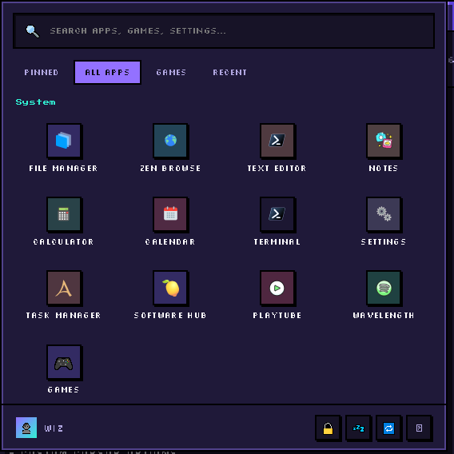

# Zen OS
Zen OS is a browser-based operating system simulator built with HTML, CSS, Javascript.

My ideal is Designed to Recreate Experience of using A desktop operating system directly inside a web browser. it includes a desktop environment, application windows, a taskbar, system settings, a virtual filesystem, process management, and several built-in applications.

The goal of Zen OS is not to replace a real operating system, but to demonstrate how many operating system concepts can be Recreated and simulated using modern web technologies.

## Live Demo

(https://zen-os-inky.vercel.app/)

## Features

### Desktop Environment

Zen OS provides a complete desktop-style interface with:

- Desktop icons
- Application launcher
- 