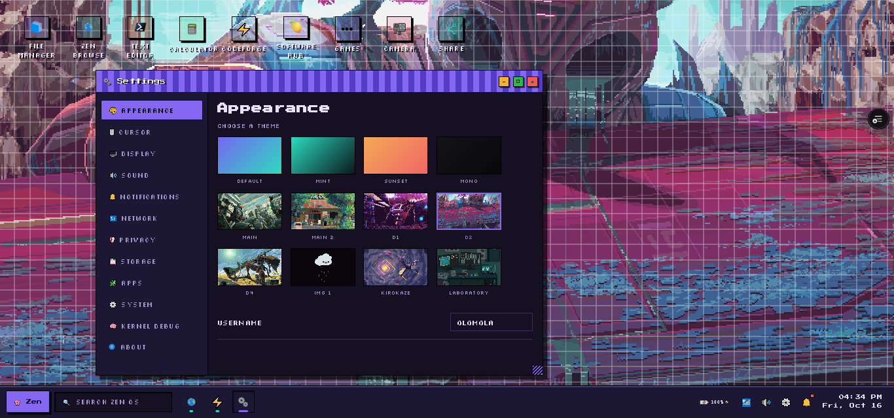
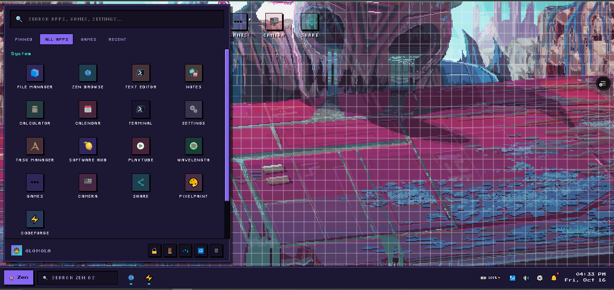
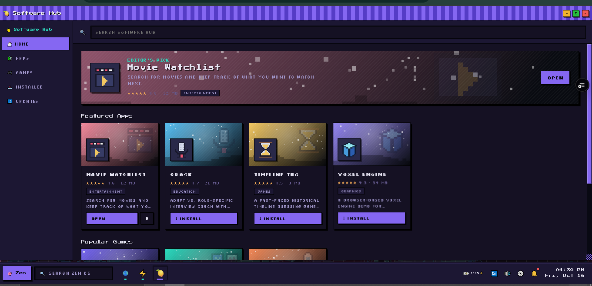
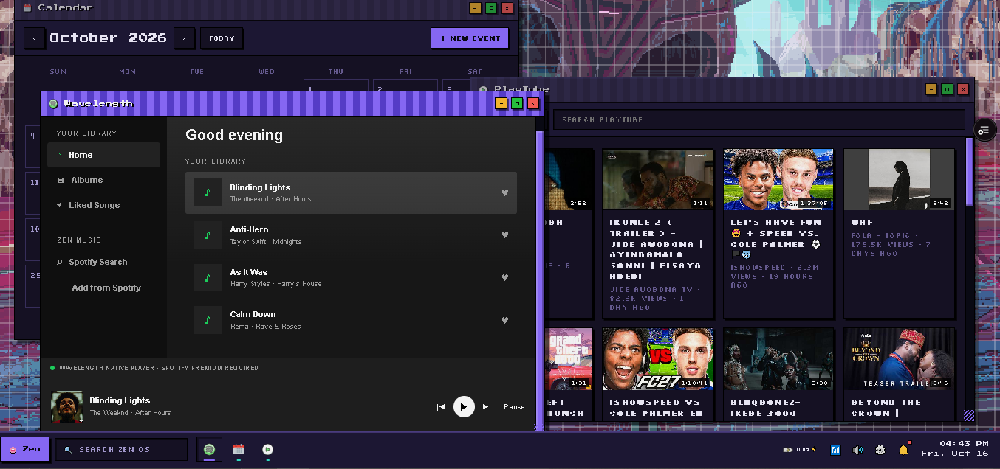

# Zen OS

Zen OS is a project I've been working on to recreate a desktop environment in the browser using HTML, CSS, and JavaScript.

I wanted to see how far I could push the idea, so I started adding things you'd normally find on a desktop, like windows, a file manager, a terminal, settings, and other apps. It's still a work in progress, and I'm constantly finding things to fix or improve.

**Live demo:** https://zen-os-inky.vercel.app/

## Screenshots

## What I've built so far

Zen OS has a desktop with icons, wallpapers, a taskbar, a system tray, and a launcher. You can open multiple apps, move their windows around, minimize or maximize them, and switch between running apps.

Some of the apps I've built include:

- File Manager
- Text Editor and Notes
- Calculator and Calendar
- Terminal
- Settings and Task Manager
- Software Hub
- Zen Browse
- PlayTube
- Wavelength
- Share

The File Manager has its own virtual filesystem where you can create folders and files, edit them, rename them, and delete them. The Software Hub also has a collection of apps and games that can be launched from the desktop.

I've added a few games too, including Cross or Crash, Memory Game, Space Shooter, Flappy Bird, The Exit, You Are Not Alone, and Lagos Life.

## Browser apps and other features

Zen Browse lets you open websites inside Zen OS, although some sites don't work properly in an embedded browser.

PlayTube uses YouTube embeds, while Wavelength uses Spotify embeds. The Share app uses WebRTC to transfer files directly between browsers, with Supabase Realtime helping them establish a connection. Bluetooth support depends on the browser and device.

## Saving data and accounts

Zen OS saves data in the browser, so it can work without a backend. I've also been working on Supabase integration to support accounts and syncing data between devices.

Users can back up and restore their profiles through Settings → Storage → Backup. Cloud syncing is still being worked on, and simultaneous changes from multiple devices can overwrite each other.

To enable the cloud features, you'll need a Supabase project. The SQL setup is in `supabase/schema.sql`, and the project URL and public anon key go in `supabase-config.js`. You'll also need to configure the allowed URLs in Supabase Authentication.

Zen OS doesn't use a service-role key in the browser.

## Built with

HTML, CSS, JavaScript, SVG, browser APIs, Local Storage, IndexedDB, and Supabase.

## What's next?

I'm still working on Zen OS, mainly trying to make the existing features more reliable. There's more work to do on the browser, storage, accounts, and file management.

I also want to add more apps and games, improve desktop customization, and eventually build **Owl**, an AI assistant for Zen OS.

## Author

Taiwo Jegede