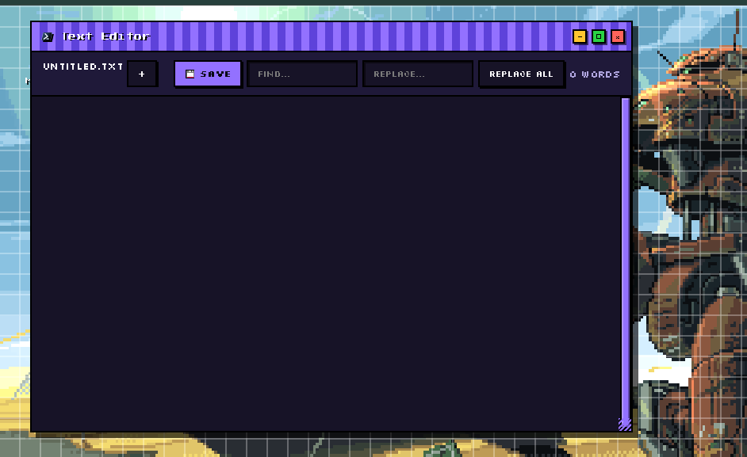
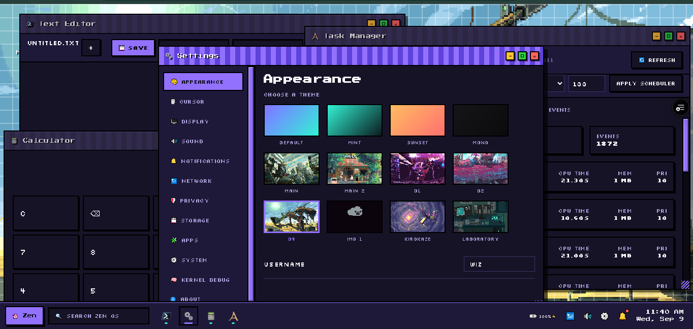
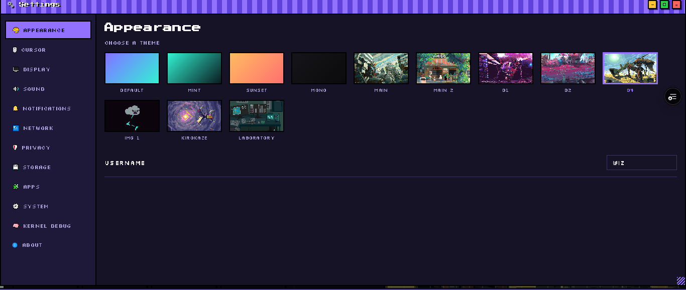
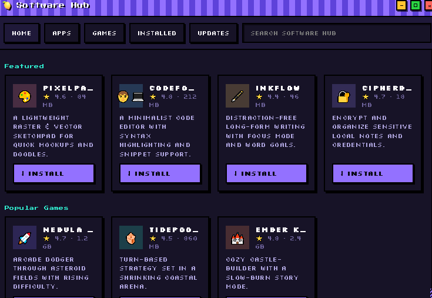
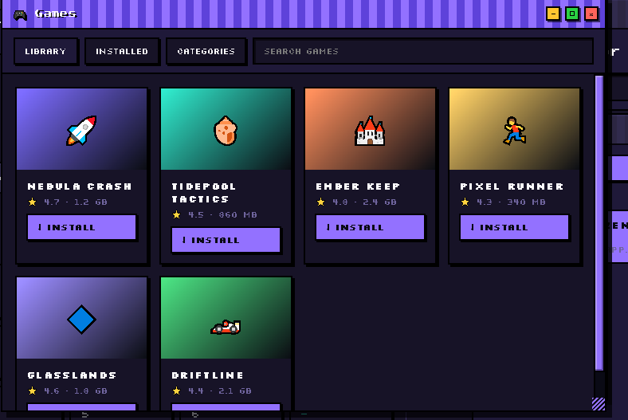
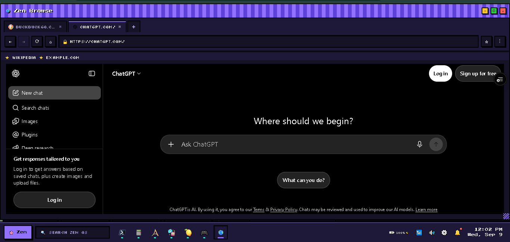

# Zen OS

Zen OS is a browser-based desktop environment built with HTML, CSS, and JavaScript. I’m building it to explore how much of a desktop operating system experience I can recreate inside a browser.

It is not meant to replace a real operating system. The project is mainly for experimenting with window management, browser APIs, local data, and small web applications.

## Live demo

https://zen-os-inky.vercel.app/

## Features

### Desktop Environment

The desktop currently includes:

- Desktop icons
- Application launcher
- Taskbar
- System tray
- Draggable application windows
- Window controls
- Custom cursor
- Desktop context menu
- Wallpapers
  
### Built-in applications

- File Manager
- Text Editor
- Notes
- Calculator
- Calendar
- Terminal
- Settings
- Task Manager
- Software Hub
- Zen Browse
- PlayTube (YouTube)
- Wavelength (Spotify)
- Share

### Virtual filesystem

The file manager provides a small filesystem stored in the browser. It supports:
- Create folders
- Create text files
- Open files
- Edit files
- Rename files
- Delete files
- Navigate between folders

### Window management

Users can:
-  Open multiple applications
-  Move windows around
-  Minimize windows
-  Maximize windows
-  Close windows
- Switch between running applications

### Settings

Settings currently covers:
- Display
- Sound
- Notifications
- Network
- Privacy
- Storage

Wi-Fi is simulated. Bluetooth uses the browser's Web Bluetooth device picker when supported. The Share app uses an encrypted WebRTC connection to transfer photos, documents, videos, and other files directly between two browsers.

### Task manager

Task Manager shows the applications and processes currently running in the session.

### Software Hub

Software Hub lets users install and remove the web applications and games listed in the catalog. Installation is simulated; some apps open real websites or embedded services.

### Games

The Games section contains browser games that can be installed and launched from Zen OS. Current entries include Cross or Crash, Memory Game, Space Shooter, Flappy Bird, The Exit, You Are Not Alone, and Lagos Life.

### Web applications

Some parts of Zen OS connect to real services.

**PlayTube** uses YouTube embeds for playing videos.

**Wavelength** uses Spotify embeds for music.

**Zen Browse** can load websites inside the desktop environment.

Because of browser security restrictions, some websites may not work correctly when loaded inside Zen Browse.

## Storage and accounts

Zen OS automatically saves changed state locally and also saves when the page is hidden or closed. When Supabase is configured, the signed-in user's state is synced to the cloud in the background. Without Supabase, the app works as a local-only application.

The local copy can be removed if browser storage is cleared. Cloud sync currently stores the user's state as one JSON document, so simultaneous edits on two devices use the most recent save.

### Supabase setup

Step 1. I create a Supabase project and open the SQL Editor.
Step 2. Then run `supabase/schema.sql`.
Step 3. I put the project URL and public anon key in `supabase-config.js`.
Step 4. After i added the deployed site and local development URL under Supabase Authentication → URL Configuration.
Step 5. Then run Zen OS over HTTPS or localhost. Password recovery does not work reliably from a `file://` URL.

The SQL i created creates the `user_state` table, row-level security policies, username reservations, username login support, and password recovery support. Usernames are case-insensitive and stay unavailable while their account exists. Deleting the original account releases the username. Supabase Realtime is used only to exchange WebRTC connection details; the transferred files do not pass through Supabase.

My app never uses a Supabase service-role key in the browser. When an older local profile matches the username of a new Supabase account, Zen OS offers to import it during the first sign-in. Users can also download or restore a profile from **Settings → Storage → Backup**. Backups are JSON files and can be kept before changing storage providers or clearing browser data.

## Built with

- HTML
- CSS
- JavaScript
- SVG
- Browser APIs
- Local Storage and IndexedDB
- Supabase Auth and PostgreSQL (optional)

## Status

Zen OS is still under active development. I’m currently working on making window management, local and cloud storage, sign-in, and the built-in apps more reliable.

## Possible future work

- Planning on adding more built-in applications and games
- Creating a better file management
- More desktop customization
- More browser and media features
- Improved hardware support where browser APIs allow it
- Optional encrypted backups and better conflict handling
- Bringing ai assitance called Owl

## Author

**Taiwo Jegede**
